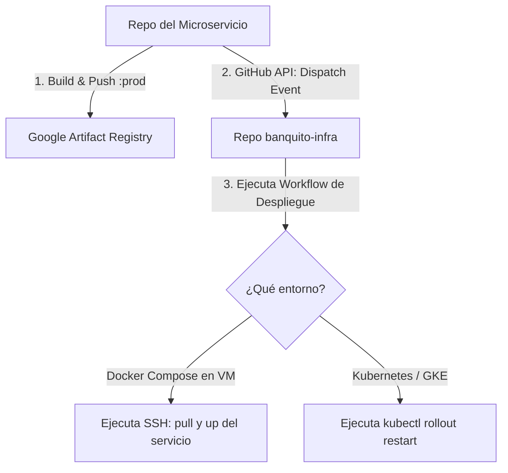

# Guia: Automatizacion del despliegue mediante disparadores (Trigger-Based)

Este documento describe como automatizar el despliegue de tus microservicios de forma dirigida y segura. Cuando un microservicio termina de compilarse y subirse a Google Artifact Registry (GAR), este notifica al repositorio de infraestructura `banquito-infra1` mediante un disparador `repository_dispatch` para actualizar y reiniciar unicamente ese servicio.

---

## 1. Flujo General del Despliegue



Este enfoque te permite mantener la etiqueta estatica `:prod` y aun asi asegurar que la infraestructura descargue la ultima imagen y levante el servicio de forma automatizada.

## Implementacion actual para `k8s/core`

El flujo ya quedo alineado con los deployments reales del namespace `banquito-core`.

- Workflow receptor: `.github/workflows/k8s-deploy-core-back.yml`
- Namespace: `banquito-core`
- Cluster esperado: `banquito-cluster`
- Estrategia: `repository_dispatch` + `kubectl rollout restart`
- Requisito clave: todos los deployments del core usan `imagePullPolicy: Always`

### Mapeo de imagen a deployment

El `client_payload.service` que envien los otros repos puede usar el nombre de la imagen o un alias conocido. El workflow lo traduce asi:

- `banquito-core-seguridad` -> `banquito-core-seguridad-3p`
- `banquito-core-clientes` -> `banquito-core-clientes-3p`
- `banquito-core-admin` -> `banquito-core-admin-3p`
- `banquito-core-contable` -> `banquito-core-contable-3p`
- `banquito-core-documentos` -> `banquito-core-documentos-3p`
- `banquito-core-notificaciones` -> `banquito-core-notificaciones-3p`
- `banquito-core-transaccional` -> `banquito-core-transaccional-3p`

Tambien se aceptan alias legacy como `identity-access-service`, `core-customer-service` o `document-service`, pero ya no son los nombres reales de los deployments en GKE.

### Payload esperado desde otros repos

Despues del `docker push ...:prod`, cada repo backend del core debe disparar este evento:

```yaml
- name: Trigger Infra Deploy
  run: |
    curl -f -X POST \
      -H "Authorization: Bearer ${{ secrets.DEVOPS_TOKEN }}" \
      -H "Accept: application/vnd.github+json" \
      https://api.github.com/repos/CamilaParedes23/banquito-infra1/dispatches \
      -d '{
        "event_type": "k8s-deploy-core-back",
        "client_payload": {
          "service": "banquito-core-seguridad"
        }
      }'
```

Solo debe cambiar el valor de `client_payload.service` segun el microservicio que construyo la imagen.

### Por que ahora si baja la imagen nueva

Como los deployments del core quedaron con `imagePullPolicy: Always`, cuando el workflow ejecuta `kubectl rollout restart`, los pods nuevos vuelven a consultar Artifact Registry aunque sigan usando la etiqueta fija `:prod`.

Sin `imagePullPolicy: Always`, Kubernetes podia reutilizar una imagen cacheada del nodo y no necesariamente bajar la version mas reciente.

---

## 2. Paso 1: Configurar el Repositorio del Microservicio (Código)

En el pipeline de GitHub Actions de tu microservicio (como el de `banquito-sw-lotes`), debes descomentar y configurar el paso final de **Trigger Infra Deploy**.

### Pipeline de tu Servicio Actualizado:
```yaml
name: Build & Push Artifact Registry Image

on:
  workflow_dispatch:
  workflow_run:
    workflows: ["Java CI with Maven"]
    types:
      - completed

env:
  GAR_LOCATION: us-central1
  GCP_PROJECT_ID: banquitog2-p3
  GAR_REPOSITORY: banquito
  IMAGE_NAME: banquito-sw-lotes # Nombre del servicio en GAR

jobs:
  docker:
    if: ${{ github.event_name == 'workflow_dispatch' || github.event.workflow_run.conclusion == 'success' }}
    runs-on: ubuntu-latest

    steps:
      - name: Checkout
        uses: actions/checkout@v4

      - name: Authenticate to Google Cloud
        uses: google-github-actions/auth@v3
        with:
          credentials_json: '${{ secrets.GCP_SA_KEY }}'

      - name: Set up Docker Auth for Artifact Registry
        run: |
          gcloud auth configure-docker ${{ env.GAR_LOCATION }}-docker.pkg.dev --quiet

      - name: Build image
        run: |
          docker build -t ${{ env.GAR_LOCATION }}-docker.pkg.dev/${{ env.GCP_PROJECT_ID }}/${{ env.GAR_REPOSITORY }}/${{ env.IMAGE_NAME }}:prod -f Docker/Dockerfile .

      - name: Push image
        run: |
          docker push ${{ env.GAR_LOCATION }}-docker.pkg.dev/${{ env.GCP_PROJECT_ID }}/${{ env.GAR_REPOSITORY }}/${{ env.IMAGE_NAME }}:prod

      # DISPARADOR ACTIVO: Notifica a banquito-infra1 para iniciar el despliegue
      - name: Trigger Infra Deploy
        run: |
          curl -f -i -X POST \
            -H "Authorization: Bearer ${{ secrets.DEVOPS_TOKEN }}" \
            -H "Accept: application/vnd.github+json" \
            https://api.github.com/repos/CamilaParedes23/banquito-infra1/dispatches \
            -d '{
              "event_type": "k8s-deploy-switch-back",
              "client_payload": {
                "service": "'"${{ env.IMAGE_NAME }}"'"
              }
            }'
```
> [!IMPORTANT]
> `DEVOPS_TOKEN` debe ser un *Personal Access Token (PAT)* creado en tu cuenta de GitHub con permisos de escritura (`repo` o `workflows`) sobre el repositorio `CamilaParedes23/banquito-infra1`. Debe configurarse en los **Secrets** del repositorio del microservicio.

---

## 3. Paso 2: Configurar el Repositorio de Infraestructura (`banquito-infra1`)

Segun la arquitectura que elijas usar para correr tus contenedores en produccion (Docker Compose en VM o Kubernetes), el workflow en el repositorio de infraestructura respondera al evento y actualizara el servicio especifico:

### Opcion A: Si usas Docker Compose en una VM (flujo legacy)

Si mantienes una VM con Docker Compose, necesitas un workflow equivalente que reciba `client_payload.service` (ej. `banquito-sw-lotes`) y ejecute el script SSH correspondiente.

#### Script de despliegue en la VM (`scripts/deploy-switch.sh`):
El script en la máquina virtual debe ejecutar la descarga de la nueva versión de la imagen y reiniciar el contenedor:
```bash
# Fragmento clave dentro de deploy-switch.sh ejecutado en la VM:
deploy_service() {
    local svc=$1
    echo "Descargando nueva versión de la imagen para: $svc..."
    docker compose pull "$svc" # Descarga la versión recién subida de GAR
    
    echo "Reiniciando contenedor: $svc..."
    docker compose up -d "$svc" # Recrea el contenedor usando la nueva imagen
}
```
* **Ventaja**: Solo se descarga y reinicia el microservicio que se acaba de actualizar, sin interrumpir los demás contenedores que corren en Docker Compose.

---

### Opción B: Si usas Kubernetes / GKE

Si deseas desplegar los servicios en tu cluster de Kubernetes usando los archivos de la carpeta `k8s/switch`, el workflow de `banquito-infra1` se autenticara en GCP y forzara una actualizacion del deployment del microservicio.

#### Workflow receptor actual (`.github/workflows/k8s-deploy-switch-back.yml`):
```yaml
name: Deploy Switch Backend to Kubernetes

on:
  repository_dispatch:
    types: [k8s-deploy-switch-back]

jobs:
  deploy:
    runs-on: ubuntu-latest
    steps:
      - name: Checkout code
        uses: actions/checkout@v3

      # Autenticación en Google Cloud para conectar a GKE
      - name: Authenticate to Google Cloud
        uses: google-github-actions/auth@v1
        with:
          credentials_json: '${{ secrets.GCP_SA_KEY }}'

      # Obtener credenciales para acceder al cluster GKE
      - name: Get GKE credentials
        uses: google-github-actions/get-gke-credentials@v1
        with:
          cluster_name: banquito-cluster
          location: us-central1

      # Ejecutar el Rollout Restart del microservicio real en GKE
      - name: Force Rollout Restart of Service
        run: |
          SERVICE_NAME="${{ github.event.client_payload.service }}"
          case "$SERVICE_NAME" in
            banquito-sw-lotes|batch-service|lotes) DEPLOY_NAME="banquito-sw-lotes-3p" ;;
            banquito-sw-pagos-internos|on-us-settlement-service|settlement|pagos-internos) DEPLOY_NAME="banquito-sw-pagos-internos-3p" ;;
            banquito-sw-pagos-externos|external-payments-service|pagos-externos) DEPLOY_NAME="banquito-sw-pagos-externos-3p" ;;
            banquito-sw-facturacion|billing-service|billing|facturacion) DEPLOY_NAME="banquito-sw-facturacion-3p" ;;
            banquito-sw-reportes|reporting-service|reporting|reportes) DEPLOY_NAME="banquito-sw-reportes-3p" ;;
            banquito-sw-sftp|sftp-service|sftp) DEPLOY_NAME="banquito-sw-sftp-3p" ;;
            *) DEPLOY_NAME="$SERVICE_NAME" ;;
          esac

          echo "Actualizando y reiniciando el deployment real: $DEPLOY_NAME"

          kubectl rollout restart deployment/$DEPLOY_NAME -n banquito-switch
          kubectl rollout status deployment/$DEPLOY_NAME -n banquito-switch --timeout=240s
```

#### Por que funciona en Kubernetes con la etiqueta `:prod`?
En Kubernetes, si una imagen tiene la etiqueta `:prod` (o `:latest`) y ejecutas `kubectl rollout restart`, el cluster creara nuevos pods y, debido a que el manifiesto tiene configurado `imagePullPolicy: Always` (como en `k8s/switch/deployment-lotes.yaml` y `k8s/switch/deployment-sftp.yaml`), Kubernetes consultara Google Artifact Registry, descargara la version mas reciente con esa etiqueta, y reemplazara progresivamente los contenedores viejos sin caida del servicio.
